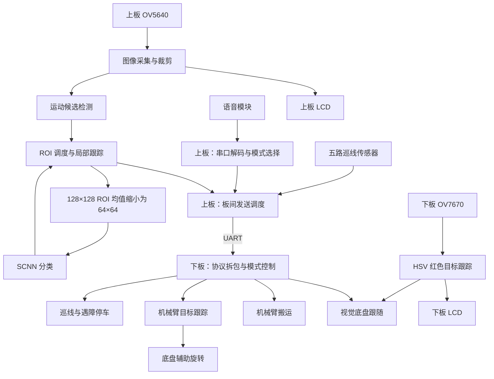

# 系统各功能逻辑、所用知识与实现方式详解

> 文档性质：基于指定 xiegithub 源码、现有日志和历史协作记录整理的技术附录，与作者正式报告配套使用。当前验证结果见 [validation.md](validation.md)。

> 版本提示：作者最终 PDF 已于 2026-11-04 按原文件纳入。本文技术记录使用最终工程重建后的 23/23、双板时序与 bit 哈希，并以 [validation.md](validation.md) 为准；PDF 正文内保留的作者交付快照不覆盖这些重建证据。

说明日期：2026 年 11 月 4 日。

本文以当前项目的实际源码连接、参数和已有验证记录为依据，说明各项功能如何触发、数据如何处理、涉及什么知识，以及怎样在 FPGA 和 Python 软件中实现。

说明范围包括三个部分：

- `../projects/merged_cam_lcd_voice_scnn/`：上板视觉与 SCNN 工程。
- `../projects/realfinal_min_102404/`：下板底盘与机械臂工程。
- `../training/scnn/`：模型训练、参数转换与数值验证。

系统的主线为：**语音选择模式 → 对应传感器提供信息 → FPGA 完成判断 → 输出底盘或舵机命令 → 摄像头继续反馈，形成控制闭环。**

本文中的验证结果来自现有日志和发布清单；编写本文时核对了登记文件与比特流的哈希，没有重新运行综合、实现、仿真或实物测试。

## 1. 系统分工与总体逻辑

| 部分 | 主要任务 | 顶层或入口 |
|---|---|---|
| 上板 `merged_cam_lcd_voice_scnn` | OV5640 图像采集、运动候选检测、SCNN 无人机分类、ROI 跟踪、语音接收、巡线传感器采集、板间发送 | `top.v` |
| 下板 `realfinal_min_102404` | 模式切换、巡线、超声波遇障停车、颜色视觉跟随、机械臂搬运、无人机目标跟踪、底盘辅助转向 | `super_top.v` |
| 软件 `jiaoben` | SCNN 模型、训练与微调、定点参数转换、数值一致性验证 | `model.py`、`train.py`、`convert_weights.py` |

从顶层连接看，主要实时功能由 FPGA 中的 Verilog 数据通路和状态机完成。Python 用于离线模型训练、参数转换和验证。



如果阅读器不支持 Mermaid，可按以下数据流理解：上板接收语音及五路巡线信号，同时完成无人机候选检测、分类和 ROI 跟踪；串口将模式、巡线状态和目标框发送给下板；下板按当前模式选择底盘或机械臂控制逻辑。下板另有一条独立的 OV7670 红色目标跟随链路。

源码入口：[上板顶层](../projects/merged_cam_lcd_voice_scnn/rtl/top.v)、[下板顶层](../projects/realfinal_min_102404/realfinal.srcs/sources_1/new/super_top.v)。

## 2. 语音控制：接收命令编号，再切换工作模式

### 2.1 功能逻辑

FPGA 接收到的是语音模块已经识别好的命令编号。当前源码中的串口帧格式为：

```text
AA 55 CMD 55 AA
```

例如 `CMD = 03` 时，选择模式 3。

处理顺序为：

1. `uart_rx` 将串行电平还原为字节。
2. `asr_frame_decode` 按顺序检查帧头、命令和帧尾。
3. 收到完整有效帧后，输出一个时钟周期的 `cmd_valid`。
4. `top_asr_voice` 更新 `mode`，并输出 `mode_upd`。
5. 上板将命令发送给下板，下板生成对应模块的使能信号。

当前模式映射为：

| 编号 | 功能 |
|---|---|
| 0 | 上电初始状态 |
| 1 | 巡线与超声波遇障停车 |
| 2 | 下板摄像头颜色目标跟随 |
| 3 | 上板无人机识别与跟踪，下板机械臂及底盘协同跟踪 |
| 4 | 停止运行，并触发搬运机械臂的停止命令路径 |
| 5 | 执行一次机械臂搬运流程 |

### 2.2 所用知识

UART 通信、协议解析、有限状态机、边沿事件与模式互斥。

UART 解决字节收发；协议状态机解决一串字节何时构成有效命令；模式寄存器记录当前工作状态；使能信号将模式映射到具体执行模块。

### 2.3 实现方式

帧解析器只有在按顺序收到规定字节后才提交命令。下板通过对模式寄存器进行比较，生成 `xunbi_en`、`vision_en`、`defense_en`、`arm_en`。这些使能对应不同模式，因此顶层能够选择当前应由哪个模块控制执行器。

语音侧还支持收到命令后的延时回传；错误标志会保持到复位，便于观察通信异常。

源码：[语音帧解析](../projects/merged_cam_lcd_voice_scnn/rtl/asr_frame_decode.v)、[语音模式及回传](../projects/merged_cam_lcd_voice_scnn/rtl/top_asr_voice.v)、[下板模式映射](../projects/realfinal_min_102404/realfinal.srcs/sources_1/new/voice_mode_select.v)。

## 3. 摄像头采集：把字节流变成带坐标的像素流

### 3.1 功能逻辑

上板 OV5640 配置的图像尺寸为 `640×480`，输出 RGB565 数据。摄像头接口每次提供 8 位数据，FPGA 将连续两个字节拼成一个 16 位像素：

```text
第一个字节 → 暂存高 8 位
第二个字节 → 拼成 RGB565 像素
```

RGB565 中，R 占 5 位，G 占 6 位，B 占 5 位。

采集模块结合 `VSYNC`、`HREF` 和像素时钟，维护行列计数，并从原始画面中裁出 `600×400` 区域。顶层设置的裁剪起点为原图 `(20,40)`。

裁剪后的数据分成三条用途不同的路径：

| 路径 | 处理方式 | 用途 |
|---|---|---|
| 预览路径 | 水平、垂直各隔一个像素取样，保存为 `300×200` | LCD 显示 |
| 检测路径 | 使用同样的半分辨率像素 | 运动候选检测 |
| 网络路径 | 从选定位置提取 `128×128` ROI，再缩小 | SCNN 分类 |

### 3.2 所用知识

摄像头时序、字节拼接、像素坐标计数、图像裁剪、下采样和存储地址生成。

行场同步说明像素属于哪一行、哪一帧；像素有效信号说明何时接收数据；行列计数把连续数据流转换为二维图像位置。

### 3.3 实现方式

显示、候选检测和分类共享摄像头输入，同时各自使用适合的图像规模。预览缓存采用行优先地址：

```text
address = y × 300 + x
```

摄像头配置由寄存器表和 I²C 驱动状态机完成。上板设置的摄像头从地址为 `0x3C`，I²C 目标频率为 `250 kHz`。

源码：[摄像头与缓存接入](../projects/merged_cam_lcd_voice_scnn/rtl/top.v)、[RGB565 采集](../projects/merged_cam_lcd_voice_scnn/rtl/ov5640_capture.v)、[配置寄存器表](../projects/merged_cam_lcd_voice_scnn/rtl/i2c_ov5640_rgb565_cfg.v)、[I²C 驱动](../projects/merged_cam_lcd_voice_scnn/rtl/i2c_dri.v)。

## 4. 运动候选检测：从画面变化中找出值得分类的区域

### 4.1 功能逻辑

`motion_detector` 工作在 `300×200` 网格上。它的输出是候选位置，之后仍需 SCNN 判断该区域是否像无人机。

#### 第一步：计算近似亮度

代码把 RGB565 展开为 8 位通道后，用移位和加法计算：

```text
Y ≈ (2R + 5G + B) / 8
```

后续帧差只需处理一个亮度值。

#### 第二步：对比前后帧

当前亮度与上一帧同位置亮度相减，并减去整体亮度变化的补偿量：

```text
corrected_diff = current_Y − previous_Y − mean_shift
```

当绝对差值大于 `20` 时，该位置被认为有明显变化。

这里的 `mean_shift` 是通过帧亮度总和之差右移得到的低成本近似补偿，不能描述成精确的逐帧平均亮度差。

#### 第三步：抑制孤立变化

代码要求同一行中相邻的两个像素连续命中，才参与运动统计。较暗的运动像素使用更高权重。

#### 第四步：进行分块统计

每个块大小为 `10×10`，整幅检测图形成 `30×20` 个统计块。模块先找到最强块，再在其邻域内聚合有效块，用权重计算候选中心：

```text
中心位置 ≈ Σ(块位置 × 块权重) / Σ块权重
```

除主候选外，还寻找空间上分离的第二候选。如果整幅画面的变化总量过大，则抑制候选，避免把大范围画面变化直接当成目标运动。

#### 第五步：比较候选的运动历史

`motion_candidate_priority` 为两个候选维护近期轨迹。当前默认历史窗口为 8 次采样，结合以下条件判断是否优先选择持续移动的候选：

- 主要坐标轴位移达到设定值。
- 有足够多次有效移动。
- 净位移与累计路径长度具有一定一致性。

因此，持续向一个方向移动的次强候选，有机会优先于局部反复抖动的主候选。

#### 第六步：稳定输出位置

检测器还包含连续候选确认、中心死区、平滑、小范围保持及边界限制。小位移不会立即推动框，大位移则采用不同处理，避免统一平滑导致明显滞后。

### 4.2 所用知识

帧差法、亮度补偿、空间聚合、加权质心、轨迹关联、时间确认和低通平滑。

帧差找到变化；分块把大量像素压缩为少量统计量；质心给出代表位置；轨迹历史帮助区分持续移动与往复抖动；时间确认和平滑降低单帧噪声影响。

### 4.3 实现方式

FPGA 实现采用帧存储器、块计数数组及多阶段扫描状态机。质心除法分多个时钟周期计算，避免把整个除法和所有候选扫描集中在单个组合路径中。

源码：[运动检测](../projects/merged_cam_lcd_voice_scnn/rtl/motion_detector.v)、[候选历史排序](../projects/merged_cam_lcd_voice_scnn/rtl/motion_candidate_priority.v)。

## 5. ROI 调度：决定何时识别、何时跟踪、何时重新搜索

### 5.1 功能逻辑

`roi_scheduler` 将候选检测与神经网络结果连接起来。当前 ROI 固定为 `128×128`，主要状态如下：

| 状态 | 主要行为 |
|---|---|
| `SEARCH` | 等待候选，使用初始或当前搜索区域 |
| `VERIFY` | 对候选区域进行分类确认 |
| `TRACK` | 已锁定，进行局部位置跟踪 |
| `REACQUIRE` | 验证明显偏离原位置的新候选 |
| `LOST_CHECK` | 局部跟踪持续丢失后重新分类 |
| `PERIODIC_CHECK` | 已锁定期间进行周期分类复检 |

当前确认条件是：**在 5 次分类结果的窗口中，至少 3 次满足无人机判据，才进入锁定。**

进入跟踪后，运动检测器主要在当前窗口内部寻找暗色像素聚集区域，根据像素数量和与参考中心的距离选择跟踪位置。这样可以在两次分类之间继续更新位置。

其他关键逻辑包括：

- 候选仅发生小幅移动时，更新 ROI。
- 候选距离过远时，先经过多帧确认，再进入重新捕获。
- 新位置验证失败时，可以恢复保存的旧 ROI。
- 局部跟踪连续丢失达到 45 帧时，进入丢失复检。
- 定时器约每 2 秒提出复检请求，由空闲的调度逻辑接受。
- 周期复检中，无人机输出计数连续 5 次不超过 10，会退回搜索。
- 图像采集或推理事务尚未结束时，`roi_hold` 冻结坐标，保证本次输入区域与结果对应。

### 5.2 所用知识

有限状态机、滑动窗口投票、迟滞、事务锁定、超时和重捕获策略。

### 5.3 实现方式与坐标语义

调度器保存当前 ROI、旧 ROI、分类历史和若干确认计数器。帧同步驱动位置决策，分类有效事件驱动识别状态变化，`roi_hold` 在一次采集与推理事务中保持输入区域一致。

这个框的尺寸始终为 `128×128`，作为当前识别和跟踪窗口；候选位置围绕窗口中心更新，为 SCNN 提供稳定尺寸的输入区域。

源码：[ROI 调度状态机](../projects/merged_cam_lcd_voice_scnn/rtl/roi_scheduler.v)、[周期复检定时器](../projects/merged_cam_lcd_voice_scnn/rtl/periodic_recheck_timer.v)、[顶层事务控制](../projects/merged_cam_lcd_voice_scnn/rtl/top.v)。

## 6. ROI 预处理：把 128×128 区域变成 64×64 彩色输入

### 6.1 功能逻辑

`roi_resampler` 对每个 `2×2` 像素块分别计算 R、G、B 均值：

```text
output_R = (R00 + R01 + R10 + R11) / 4
```

G、B 通道使用相同规则，因此：

```text
128×128×RGB565 → 64×64×RGB888
```

### 6.2 所用知识

行缓存、均值滤波、位宽扩展、移位除法和双缓冲。

### 6.3 实现方式

1. 在帧边界之后锁存 ROI 坐标。
2. 用一行缓存保存前一行像素。
3. 当前行到来时，组合上下两行、左右两列的四个像素。
4. 使用 10 位加法结果保存四个 8 位通道值之和。
5. 右移两位得到均值。
6. 生成 4096 个输出像素的地址和写使能。
7. 最后一个像素完成后，发出 `frame_done`。

这是 **2×2 均值下采样**。网络输入采用双缓冲，写入完成后发布缓冲区编号，再由网络读取对应完整区域。

源码：[ROI 均值采样](../projects/merged_cam_lcd_voice_scnn/rtl/roi_resampler.v)、[网络输入双时钟缓存](../projects/merged_cam_lcd_voice_scnn/rtl/drone_frame_ram.v)。

## 7. SCNN：对 ROI 内的内容做无人机二分类

### 7.1 网络结构

当前实际接入的网络结构为：

| 阶段 | 运算 | 输出尺寸 |
|---|---|---|
| 输入 | 彩色像素概率脉冲编码 | `64×64×3` |
| 卷积 1 | `3×3`，3→8 通道，padding=1，再经过 LIF | `64×64×8` |
| 池化 1 | `2×2 OR` | `32×32×8` |
| 卷积 2 | `3×3`，8→16 通道，padding=1，再经过 LIF | `32×32×16` |
| 池化 2 | `2×2 OR` | `16×16×16` |
| 池化 3 | `2×2 OR` | `8×8×16` |
| 全连接 | 1024→2，再经过 LIF | 2 个输出 |
| 决策 | 累计 50 个时间步的输出脉冲 | 非无人机／无人机 |

参数总数为：

```text
卷积1：3 × 8 × 3 × 3 = 216
卷积2：8 × 16 × 3 × 3 = 1152
全连接：1024 × 2 = 2048

合计：3416
```

三层权重均不包含 bias。

### 7.2 输入脉冲编码

每个颜色通道产生伪随机字节，与像素强度比较：

```text
spike = random_byte < pixel_intensity
```

像素越亮，越容易在时间步中产生脉冲。随机数由 LFSR 产生。

输入字保存为 `RRGGBB`，RTL 从低字节开始读取通道，因此网络通道实际顺序为 **B、G、R**；Python 数据集也按照这个顺序转换。

### 7.3 卷积计算

输入已经是 0/1 脉冲，因此代码通过条件选择完成权重贡献：

```text
输入脉冲为 1 → 加上对应权重
输入脉冲为 0 → 加 0
```

卷积引擎按输出位置和卷积核位置进行扫描；通道方向使用并行加法逻辑。超出图像边界的位置按零处理。

### 7.4 LIF 神经元

当前使用的膜电位更新规则是：

```text
candidate = v + ((I − v) >>> 1)
```

其中：

- `v` 是前一时间步膜电位。
- `I` 是当前输入电流。
- `>>> 1` 是带符号算术右移。
- 阈值为 `4096`，对应 Q12 中的实数 1。
- 达到阈值后输出脉冲，并将膜电位清零。
- 未达到阈值时保存 `candidate`。

卷积层每个位置都有自己的膜电位状态，由 `lif_bram` 存储；同一图像的时间步之间保留状态，开始处理新图像时清零。

权重为有符号 16 位、12 位小数，电流和膜电位为有符号 26 位。软件模型也显式处理对应的有限位宽回绕和算术右移规则。

### 7.5 池化

四个脉冲按通道做 OR：

```text
pooled_spike = s00 OR s01 OR s10 OR s11
```

在二值输入上，这与取最大值具有相同结果。

### 7.6 输出判决

两个输出神经元分别对应：

```text
类别0：not_drone
类别1：drone
```

网络内部选择脉冲计数更多的类别，相同计数选择类别 0。

当前上板跟踪系统使用更严格的外层判据：

```text
drone_count ≥ not_drone_count + 8
```

它再结合“5 次至少命中 3 次”的时间确认，决定是否锁定。

这些计数及计数差直接形成硬件判决依据，并通过“5 次至少 3 次”的时间确认提高稳定性。50 个时间步表示同一个 ROI 在脉冲网络中的迭代过程，用于形成事件驱动的二分类结果。

### 7.7 所用知识与硬件组织

涉及卷积网络、脉冲编码、LIF 动态、定点数、条件累加、BRAM 状态存储、时分复用和分层状态机调度。

顶层控制器对每个时间步依次启动输入编码、卷积池化链和全连接分类器，并等待各阶段的完成事件。卷积池化链内部再按层调度，使用脉冲 RAM 保存中间特征；权重从 ROM 读取，膜电位存储在独立状态存储器中。

源码：[网络连接](../projects/merged_cam_lcd_voice_scnn/rtl/scnn_chain.v)、[时间步控制](../projects/merged_cam_lcd_voice_scnn/rtl/control_unit_cnn.v)、[输入编码](../projects/merged_cam_lcd_voice_scnn/rtl/input_frontend.v)、[卷积条件累加](../projects/merged_cam_lcd_voice_scnn/rtl/conv_engine.v)、[LIF 更新](../projects/merged_cam_lcd_voice_scnn/rtl/lif_neuron_cell.v)、[卷积膜电位存储](../projects/merged_cam_lcd_voice_scnn/rtl/lif_bram.v)、[全连接分类器](../projects/merged_cam_lcd_voice_scnn/rtl/fc_classifier.v)、[输出计数与判决](../projects/merged_cam_lcd_voice_scnn/rtl/output_logic.v)。

## 8. 板间通信：在同一条串口上传输命令、巡线状态和目标框

### 8.1 功能逻辑

上下板使用 `115200` 波特率串口。每个逻辑数据字节都封装成：

```text
AA 55 DATA 55 AA
```

逻辑上承载三种内容：

| 类型 | 内容 |
|---|---|
| 模式命令 | 编号 1～5 |
| 巡线状态 | 最高位标识类型，低 5 位保存传感器状态 |
| 目标框 | 起始标记、坐标、尺寸、标志和校验 |

目标框逻辑包为：

```text
40 xL xH yL yH wL wH hL hH flags xor
```

每个坐标或尺寸使用低、高字节保存。最后的 XOR 校验覆盖九个数据字节。

### 8.2 所用知识

协议分层、校验、数据一致性、发送仲裁、忙闲握手和超时保护。

### 8.3 实现方式

发送侧先锁存一组完整目标框，在整个包发送完之前保持该组数据稳定；包内不会插入其他类型的数据。接收侧先收齐并校验，再一次性更新坐标和有效标志。

这就是代码中的原子更新：避免出现新一帧的 x 与旧一帧的 y 混用。

当前还设置了：

- 目标框数据年龄约 100 ms 超时失效。
- 目标框接收中断约 10 ms 后退出当前收包。
- 板间长期没有活动时，约 50 ms 后清除巡线状态。
- 上板发送前对巡线输入取反，统一为高电平有效的内部状态。

`flags` 虽然预留了标签位，但当前上板发送逻辑将标签位固定为 0，主要通过 `valid` 表示跟踪锁定状态。下板跟踪使用的也是框有效信号。

源码：[发送调度与目标框封装](../projects/merged_cam_lcd_voice_scnn/rtl/upper_link_send.v)、[单字节逻辑帧发送](../projects/merged_cam_lcd_voice_scnn/rtl/link_tx.v)、[目标框接收](../projects/realfinal_min_102404/realfinal.srcs/sources_1/new/bbox_unpack.v)、[类型分流](../projects/realfinal_min_102404/realfinal.srcs/sources_1/new/link_demux.v)。

## 9. 巡线功能：五路传感器估计偏差，再调整左右速度

### 9.1 功能逻辑

巡线模式的数据链为：

```text
五路传感器 → 上板发送 → 下板拆包 → 采样确认
→ 计算路线偏差 → 转向与速度限幅 → 四电机命令
```

五路位置采用类似以下权重：

```text
左外、左内、中间、右内、右外
 −2    −1    0     +1    +2
```

命中多路时，控制器计算加权平均位置。代码使用倒数查表代替直接除法，并将误差放大为整数表示：

```text
error ≈ 256 × 权重和 / 有效传感器数量
```

之后进行死区处理，并计算转向量。**当前顶层配置中，积分项和微分项均关闭，实际使用比例控制。**

当前主要参数为：

- 控制周期约 10 ms。
- 基础速度命令 18。
- 转向和最终巡线速度均有限幅。
- 转向量越大，基础前进速度越低。
- 丢线确认后进行有限时间左右搜索。
- 搜索总时长配置为 320 ms，搜索失败后停车。

左右速度组合为：

```text
left  = effective_base + turn
right = effective_base − turn
```

顶层再根据电机安装方向映射为四个带符号速度命令。这里的 18、20 等数值是协议中的速度命令值，源码没有把它们标定成实际厘米每秒。

### 9.2 直角处理

直角处理由独立状态机接管：

```text
检测左右三路特征
→ 连续确认
→ 前进
→ 原地转向
→ 重新看到线路或超时退出
→ 冷却后恢复普通巡线
```

当前启用了重新见线退出条件：转向侧外传感器要先离开线路，再重新检测到线路，并满足最短转向时间。虽然保留了 `SPIN_MS=700` 参数，当前模式并非固定转满 700 ms 后结束。

### 9.3 所用知识与实现方式

涉及多传感器加权定位、离散比例控制、死区、限幅、弯道减速、丢线搜索和行为状态机。

普通巡线、直角动作和遇障状态分别产生控制信息，由 `xunbi_core` 仲裁。遇障或符合停车条件时输出零速度；直角动作期间使用直角状态机速度；其余情况下使用巡线控制器速度。

源码：[巡线总控制](../projects/realfinal_min_102404/realfinal.srcs/sources_1/new/xunbi_core.v)、[控制器计算](../projects/realfinal_min_102404/realfinal.srcs/sources_1/new/line_pid_ctrl.v)、[直角状态机](../projects/realfinal_min_102404/realfinal.srcs/sources_1/new/corner_turn.v)。

## 10. 超声波功能：检测近距离障碍，停车并等待恢复

### 10.1 功能逻辑

当前超声波逻辑主要实现遇障停车与恢复：

1. 发出约 10 μs 的触发脉冲。
2. 等待 Echo 拉高。
3. 统计 Echo 高电平持续时间。
4. 按代码中的时间换算系数得到距离。
5. 多次确认后更新 `avoid_active`。
6. 巡线总控制检测到该信号后，将左右速度置零。

距离状态采用不同的进入、退出门限：

- 测得距离大于 2 cm 且不超过 10 cm，连续确认后进入遇障状态。
- 达到 12 cm 或以上，满足退出确认和最短保持时间后恢复。
- 障碍状态至少保持约 100 ms。
- 恢复后逐步放开速度上限，约经过 320 ms 的斜坡阶段。

### 10.2 所用知识与实现方式

涉及脉宽测量、同步采样、测距换算、多次确认、迟滞和斜坡恢复。

计数器测量高电平时长；状态机管理触发、等待上升沿、等待下降沿和超时；近、远计数器提供多次确认；不同进入和退出门限形成迟滞，防止距离在单一门限附近变化时反复启停。

### 10.3 避障控制范围

当前逻辑在近距离障碍出现时执行停车与斜坡恢复，回波超时按远距离结果处理，形成面向受限场地通行的实时避障路径。

源码：[超声波状态机](../projects/realfinal_min_102404/realfinal.srcs/sources_1/imports/imported/xunbifinal/xunjibizhang02.srcs/sources_1/new/obstacle_avoid_ctrl.v)、[停车仲裁及恢复斜坡](../projects/realfinal_min_102404/realfinal.srcs/sources_1/new/xunbi_core.v)。

## 11. 颜色视觉跟随：识别红色区域，通过位置和大小控制底盘

### 11.1 功能逻辑

该功能使用下板 OV7670：

```text
摄像头 → RGB565 → HSV → 红色像素筛选
→ 目标中心与尺寸估计 → 底盘跟随
```

下板采集区域为 `300×400`。RGB 转 HSV 使用流水线实现，输出有效信号与像素数据经过相同延迟，颜色统计的帧边界也做了对齐。

当前目标像素条件为：

```text
与红色色相的环形差值 ≤ 30°
S > 50
V > 40
```

需要区分保留结构与实际行为：代码虽然累加了中心区域的 HSV 值，但锁定时将目标色相直接设为 0，所以**当前实际跟随红色**。

目标估计过程是：

- 累加目标像素的 x、y 坐标。
- 除以像素数量，得到中心。
- 根据像素相对上一目标中心的平均绝对偏移，估算宽高。
- 对中心和尺寸变化限速，并平滑尺寸。
- 已有可靠目标时，在其附近区域继续搜索，减少远处同色区域干扰。

宽高是统计估计结果，不能当作逐像素最小包围框。

### 11.2 底盘控制

底盘控制使用：

```text
current_size = max(width, height)
前后误差 = reference_size − current_size
转向误差 = box_y − 200
```

进入模式约 0.3 秒后记录目标大小作为距离参考。之后根据目标大小变化调整前后运动，根据位置偏差调整转向；控制周期约 50 ms，速度命令限制在 ±12。

这里使用 `box_y` 控制转向与下板画面的旋转显示映射有关，解释坐标时要结合其显示方向。

### 11.3 所用知识与实现方式

涉及 HSV 分割、色相环形距离、质心、统计尺寸估计、局部搜索、低通滤波和基于图像误差的闭环控制。

HSV 流水线持续接收像素；统计模块按帧累加并锁存结果；多周期除法器计算中心和尺寸；底盘控制器定期滤波误差、计算速度并限幅。

源码：[颜色跟踪](../projects/realfinal_min_102404/realfinal.srcs/sources_1/imports/imported/shijuefinal/project_7.srcs/sources_1/new/color_track.v)、[HSV 流水线](../projects/realfinal_min_102404/realfinal.srcs/sources_1/imports/imported/shijuefinal/project_7.srcs/sources_1/new/rgb2hsv.v)、[底盘跟随控制](../projects/realfinal_min_102404/realfinal.srcs/sources_1/imports/imported/shijuefinal/project_7.srcs/sources_1/new/chassis_control.v)。

## 12. 无人机目标跟踪：机械臂先调整，达到转动边界后由底盘辅助

### 12.1 目标坐标转换

模式 3 中，下板接收上板的固定尺寸目标窗口，先计算中心：

```text
cx = x + width / 2
cy = y + height / 2
```

再按当前安装方向转换：

```text
yaw_target   = 599 − cx
pitch_target = 399 − cy
```

### 12.2 机械臂跟踪

机械臂跟踪中心设为 `(300,200)`。目标偏离中心后，按误差计算舵机位置增量：

```text
误差在 ±16 像素以内 → 增量为 0
其他情况           → error >>> 3
最终每次增量       → 限制在 ±14
```

当前跟踪更新周期和运动时间均配置为约 100 ms。

舵机分工与范围为：

| 舵机 | 主要作用 | 当前范围 |
|---|---|---|
| 6 号 | 水平转动 | 210～750 |
| 4 号 | 主要俯仰调整 | 200～400 |
| 3 号 | 俯仰扩展 | 600～800 |

当 4 号到达边界而目标仍要求继续调整时，3 号参与俯仰调整。相关方向由符号参数控制，避免把不同安装方向写死在控制公式里。

### 12.3 底盘辅助旋转

底盘辅助旋转需要同时满足：

- 6 号舵机达到对应方向边界。
- 有效目标靠近画面同侧边缘。
- 条件持续约 300 ms。

触发后四电机形成原地旋转组合。当前最短旋转约 1 秒、最长约 2 秒；达到最短时间后，根据回中或方向条件变化退出，超时也会退出。

### 12.4 所用知识与控制方式

涉及图像误差反馈、增量比例控制、死区、步长限制、执行器限位、多关节协调和底盘与机械臂的分级控制。

图像提供目标位置反馈，舵机位置寄存器保存发送过的目标位置，二者共同形成轻量的图像伺服闭环，并由舵机边界和底盘辅助转向扩展可达范围。

源码：[坐标转换及实际参数](../projects/realfinal_min_102404/realfinal.srcs/sources_1/new/super_top.v)、[机械臂跟踪算法](../projects/realfinal_min_102404/realfinal.srcs/sources_1/new/arm_red_track.v)、[底盘辅助旋转](../projects/realfinal_min_102404/realfinal.srcs/sources_1/new/defense_spin.v)。

## 13. 机械臂搬运：按预设姿态表执行一次动作序列

### 13.1 功能逻辑

模式 5 使用 `arm_pick_place_once_top`，内部保存 12 步姿态，每一步包含六个舵机的目标位置和运动时间。

执行流程为：

```text
等待启动
→ 逐个写入六个舵机的目标位置与时间
→ 广播统一启动
→ 等待本步运动时间
→ 进入下一步
→ 第12步完成后结束
```

每次收到命令 5，`arm_voice_trigger` 会给搬运控制模块一个约 1 ms 的复位过程，使其能够从头重新执行。当前顶层配置启动等待为 3 秒，循环功能关闭。

### 13.2 舵机通信

舵机协议由统一发送器完成：

```text
55 55 ID LEN CMD 参数 CHECKSUM
```

校验为 ID、长度、命令和参数之和的低 8 位取反。

程序先分别写入各舵机的等待运动命令，再使用广播启动命令统一执行，减少逐个直接启动造成的时间差。停止命令通过广播停止路径发送。

### 13.3 所用知识与实现方式

涉及示教式动作序列、查表、定时状态机、总线舵机协议、广播同步启动和停止处理。

这部分的实现方式是预设姿态表加顺序状态机；当前没有根据物体实时位置计算抓取点，也没有在线逆运动学求解。

源码：[搬运姿态及流程](../projects/realfinal_min_102404/realfinal.srcs/sources_1/imports/imported/armfinal/project_9.srcs/sources_1/new/arm_pick_place_once_top.v)、[再次启动触发](../projects/realfinal_min_102404/realfinal.srcs/sources_1/new/arm_voice_trigger.v)、[舵机数据包发送](../projects/realfinal_min_102404/realfinal.srcs/sources_1/imports/imported/armfinal/project_9.srcs/sources_1/new/bus_servo_packet_tx.v)。

## 14. 显示、跨时钟域和执行器通信怎样配合

### 14.1 LCD 显示

LCD 使用行、场计数器产生同步与有效显示信号，根据当前屏幕坐标读取缓存，再叠加框线和文字。

上板 LCD 配置有效区为 `800×480`：

- 将 `300×200` 预览按每像素重复显示为 `600×400`。
- 叠加 `128×128` ROI 框。
- 搜索框使用红色，锁定框使用绿色。
- 显示两类输出脉冲计数。

下板使用双页图像缓存，在帧边界更新读页，并对摄像头图像进行旋转、缩放和框线叠加。

### 14.2 跨时钟域

摄像头像素时钟、系统处理时钟等属于不同的时钟域。代码针对不同数据使用了不同传输方式：

| 数据 | 当前实现方式 |
|---|---|
| 像素数据 | 双时钟存储器 |
| 完成事件 | 翻转标志，目标域同步后检测变化 |
| 下板颜色目标框 | 保持整组数据，使用请求／应答握手后采样 |
| 模式等控制信号 | 同步寄存器链 |
| 上板跟踪模块复位释放 | 各时钟域分别同步释放 |

其中，下板颜色目标框握手会保持整组坐标稳定，直到目的端确认已采样，避免仅对各位分别同步导致同一组坐标来自不同更新时刻。

### 14.3 电机命令发送

电机命令通过 `iic_w_top` 发送。它先锁存四路速度，再完成一组 I²C 操作；发送期间的新更新进入待处理状态，以保持同一组四电机命令的一致性。

### 14.4 所用知识

光栅扫描、坐标映射、流水线延迟对齐、双缓冲、跨时钟域同步、握手和命令一致性。

源码：[上板显示](../projects/merged_cam_lcd_voice_scnn/rtl/lcd_cam_text_scnn.v)、[下板显示](../projects/realfinal_min_102404/realfinal.srcs/sources_1/new/rgb_lcd_driver.v)、[下板目标框握手](../projects/realfinal_min_102404/realfinal.srcs/sources_1/new/shijue_arm_core.v)、[电机命令发送](../projects/realfinal_min_102404/realfinal.srcs/sources_1/imports/imported/shijuefinal/project_7.srcs/sources_1/new/iic_w_top.v)。

## 15. Python 训练与部署：让软件模型遵循硬件的运算规则

### 15.1 总体流程

```text
64×64 彩色 ROI 数据集
→ SCNN 训练或微调
→ 保存检查点
→ Q12 权重量化
→ 按 RTL 顺序打包
→ 导出 COE／MEM／Verilog ROM
→ 接入 FPGA 工程并验证
```

### 15.2 硬件对应的软件模型

`model.py` 使用与硬件对应的网络结构，并模拟：

- BGR 通道顺序。
- LFSR 输入编码序列。
- Q12 权重量化。
- 26 位有限位宽运算。
- LIF 算术右移和发放后清零。
- 三次二值池化。
- 50 步输出脉冲累计。

### 15.3 训练方法

训练时，脉冲阈值的前向行为仍然是硬判决；反向传播使用替代梯度：

```text
surrogate_gradient = 1 / (1 + 5 × |distance|)²
```

权重量化前向使用离散值，反向通过直通估计传递梯度。训练采用 Adam 和输出脉冲计数的交叉熵损失。

`train.py` 默认从 `parameters/final_engine_weights.json` 初始化；显式指定 `--from-scratch` 才随机初始化。训练记录包含数据文件哈希、参数来源、训练配置、准确率及检查点；训练集和验证集中逐字节相同的图像会被拒绝。

### 15.4 参数转换

`convert_weights.py` 的关键工作还包括存储排列转换：

- 卷积权重按卷积核位置及输入、输出通道组织。
- 全连接每个 64 位字保存四个 16 位权重，其特征与高低位对应关系单独处理。
- 检查张量形状、类别顺序、非有限值和数值范围。

因此，导出时既要保证数值正确，也要保证**通道、特征和存储位段的对应关系正确**。

### 15.5 数值验证范围

软件当前验证范围明确限定：一次模型调用从全局复位状态开始，输入随机序列在该图像的 50 步之间连续；硬件连续多帧时的 PRNG 状态不在这项软件等价验证范围内。

知识点包括替代梯度训练、量化感知前向、直通估计、定点数等价建模、张量排列、检查点管理和数据可追溯性。

源码：[模型及替代梯度](../training/scnn/model.py)、[训练入口](../training/scnn/train.py)、[参数打包转换](../training/scnn/convert_weights.py)、[独立数值验证](../training/scnn/verify.py)、[数据集要求](../training/scnn/data/README.md)。

## 16. 发布证据汇总

本文汇总最终源码、2026 年 11 月 4 日的仓库验证记录，以及发布清单中登记文件和比特流的哈希：登记文件均存在且匹配，两个比特流也匹配。

| 项目 | 现有记录 |
|---|---|
| 上板功能回归 | 10／10 通过 |
| 下板功能回归 | 13／13 通过 |
| 上板内部时序 WNS | 5.815 ns |
| 下板内部时序 WNS | 4.295 ns |
| 两工程 DRC 错误数 | 均为 0 |
| Python 参数往返转换 | 3416 个参数通过 |
| 软件与独立整数模型 | 参考输入、全黑输入的 50 步输出一致 |
| 最小训练流程 | 梯度、参数更新和检查点导出通过 |
| 数据集评测与板级测试 | 对应记录分别由训练工程与 board/measurements.md 承接 |

记录：[上板发布清单](../build/reports/upper/manifest.json)、[下板发布清单](../build/reports/lower/manifest.json)、[软件数值验证](../training/scnn/verification/verification.json)、[最小训练验证](../training/scnn/verification/smoke_test.json)。
